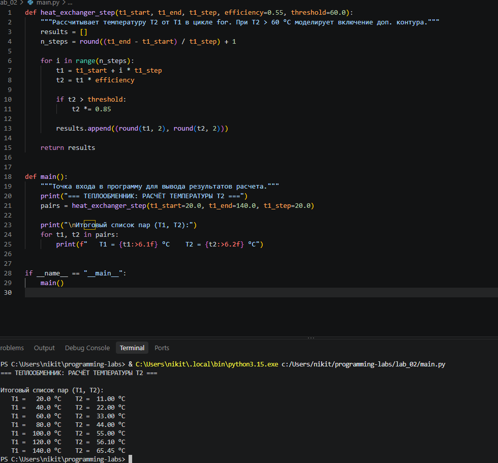

# Лабораторная работа №2

**Дисциплина:** Программирование на языке Python  
**Выполнил:** Серебро Никита Денисович (Группа: УТС-251т)  
**Вариант:** 14. Теплообменник

---

## 1. Цель работы
Изучение синтаксиса и практических возможностей условных операторов (`if-elif-else`), циклических конструкций (`while`, `for..in`) и пользовательских функций (`def`) в языке Python. Приобретение навыков декомпозиции алгоритмов управления, передачи аргументов и возврата результатов вычислений.

## 2. Краткие теоретические сведения
- **Условный оператор `if-elif-else`** используется для проверки логических условий и ветвления алгоритма. Обязательным правилом является использование двоеточия (`:`) и строгое соблюдение отступов (4 пробела).
- **Цикл `for..in` и функция `range()`**: осуществляют перебор элементов последовательности. Функция `range(start, stop, step)` генерирует арифметическую прогрессию чисел, не включая верхнюю границу `stop`.
- **Пользовательские функции (`def`)** представляют собой блоки кода с собственным именем. Они принимают параметры и возвращают результаты вычислений с помощью оператора `return`. Строки документации (`docstrings`) размещаются сразу после заголовка функции.

## 3. Задание (Вариант 14)
Разработать функцию `heat_exchanger_step(t1_start, t1_end, t1_step)`, рассчитывающую в цикле температуру T2 от T1. При T2 > 60 °C моделировать включение дополнительного контура. Функция должна возвращать список пар (T1, T2).

## 4. Листинг программы (Код)

```python
def heat_exchanger_step(t1_start, t1_end, t1_step, efficiency=0.55, threshold=60.0):
    """Рассчитывает температуру T2 от T1 в цикле for. При T2 > 60 °C моделирует включение доп. контура."""
    results = []
    n_steps = round((t1_end - t1_start) / t1_step) + 1

    for i in range(n_steps):
        t1 = t1_start + i * t1_step
        t2 = t1 * efficiency

        if t2 > threshold:
            t2 *= 0.85

        results.append((round(t1, 2), round(t2, 2)))

    return results


def main():
    """Точка входа в программу для вывода результатов расчета."""
    print("=== ТЕПЛООБМЕННИК: РАСЧЁТ ТЕМПЕРАТУРЫ T2 ===")
    pairs = heat_exchanger_step(t1_start=20.0, t1_end=140.0, t1_step=20.0)

    print("\nИтоговый список пар (T1, T2):")
    for t1, t2 in pairs:
        print(f"   T1 = {t1:>6.1f} °C    T2 = {t2:>6.2f} °C")


if __name__ == "__main__":
    main()
```
## 5. Результат выполнения программы



Текстовый вывод программы в консоли:
```text
=== ТЕПЛООБМЕННИК: РАСЧЁТ ТЕМПЕРАТУРЫ T2 ===

Итоговый список пар (T1, T2):
   T1 =   20.0 °C    T2 =  11.00 °C
   T1 =   40.0 °C    T2 =  22.00 °C
   T1 =   60.0 °C    T2 =  33.00 °C
   T1 =   80.0 °C    T2 =  44.00 °C
   T1 =  100.0 °C    T2 =  55.00 °C
   T1 =  120.0 °C    T2 =  56.10 °C
   T1 =  140.0 °C    T2 =  65.45 °C

   ```
## 6. Вывод
В ходе выполнения лабораторной работы №2 я изучил синтаксис и практические возможности условных операторов, циклов и пользовательских функций в языке Python. 

Я разработал функцию `heat_exchanger_step`, которая моделирует работу теплообменника. В ней я применил цикл `for` с функцией `range()` для перебора шагов температуры, условный оператор `if` для проверки превышения порога (60 °C) и изменения коэффициента полезного действия, а также оператор `return` для возврата списка кортежей с результатами. 

Кроме того, я закрепил навыки оформления строк документации (`docstrings`), использования параметров по умолчанию и форматированного вывода данных с помощью f-строк. Все поставленные задачи были успешно решены.