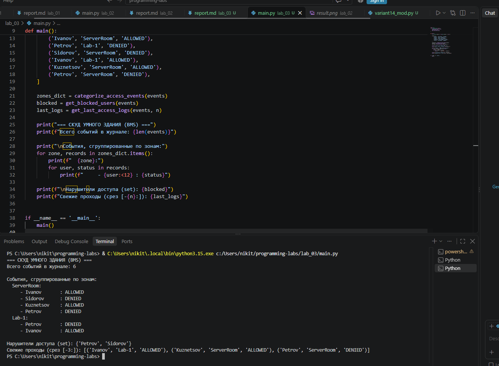

# Лабораторная работа №3

**Дисциплина:** Программирование на языке Python  
**Выполнил:** Серебро Никита Денисович (Группа: УТС-251т)  
**Вариант:** 14. Трафик СКУД и логи безопасности умного здания (BMS)

---

## 1. Цель работы
Изучение принципов модульной архитектуры программных систем в Python, правил импорта и использования системного модуля `sys`, а также практическое освоение базовых структур данных (списки, кортежи, словари, множества) и операций срезов.

## 2. Краткие теоретические сведения
- **Модуль** — это файл с расширением `.py`, содержащий код. Модули позволяют разбивать сложную программу на части.
- **`sys.argv`** — список аргументов командной строки. `sys.argv[0]` — имя скрипта, а `sys.argv[1]`, `sys.argv[2]` и т.д. — переданные параметры.
- **Конструкция `if __name__ == '__main__':`** позволяет отделить код, который запускается при прямом вызове файла, от кода, который выполняется при импорте этого файла как модуля.
- **Структуры данных:** 
  - *Списки* `[]` — изменяемые, упорядоченные.
  - *Кортежи* `()` — неизменяемые, упорядоченные.
  - *Словари* `{}` — набор пар «ключ: значение».
  - *Множества* `set()` — уникальные, неупорядоченные элементы.
- **Срезы** `[start:stop:step]` позволяют извлекать подпоследовательности. Срез `[-n:]` берет последние `n` элементов.

## 3. Задание (Вариант 14)
Разработать модуль для обработки журнала событий СКУД (системы контроля доступа). 
Требуется реализовать три функции:
1. `categorize_access_events()` — группирует события по зонам в словарь.
2. `get_blocked_users()` — извлекает множество пользователей с отказом в доступе.
3. `get_last_access_logs()` — возвращает последние `n` событий срезом.

Также необходимо написать главный скрипт, считывающий `n` из `sys.argv`, вызывающий функции модуля и выводящий отчет.

## 4. Листинг программы (Код)

### 4.1. Файл модуля (`variant14_mod.py`)

```python
def categorize_access_events(events_list):
    """Группирует события по зонам в словарь."""
    zones = {}
    for user, zone, status in events_list:
        zones.setdefault(zone, []).append((user, status))
    return zones


def get_blocked_users(events_list):
    """Извлекает множество (set) пользователей с отказом в доступе ('DENIED')."""
    return {user for user, zone, status in events_list if status == 'DENIED'}


def get_last_access_logs(events_list, n=3):
    """Извлекает последние n событий срезом [-n:]."""
    return events_list[-n:]


if __name__ == '__main__':
    # Блок автономного тестирования модуля
    test_events = [
        ('Ivanov', 'ServerRoom', 'ALLOWED'),
        ('Petrov', 'Lab-1', 'DENIED'),
        ('Sidorov', 'ServerRoom', 'DENIED'),
        ('Ivanov', 'Lab-1', 'ALLOWED'),
    ]
    
    print("[Автотест] События по зонам:", categorize_access_events(test_events))
    print("[Автотест] Заблокированные :", get_blocked_users(test_events))
    print("[Автотест] Последние 3     :", get_last_access_logs(test_events, 3))
```
### 4.2. Главный исполняемый файл (main.py)

```python
import sys
from variant14_mod import (
    categorize_access_events,
    get_blocked_users,
    get_last_access_logs,
)

def main():
    # Чтение аргумента из sys.argv[1] (дефолт 3)
    n = int(sys.argv[1]) if len(sys.argv) > 1 else 3

    events = [
        ('Ivanov', 'ServerRoom', 'ALLOWED'),
        ('Petrov', 'Lab-1', 'DENIED'),
        ('Sidorov', 'ServerRoom', 'DENIED'),
        ('Ivanov', 'Lab-1', 'ALLOWED'),
        ('Kuznetsov', 'ServerRoom', 'ALLOWED'),
        ('Petrov', 'ServerRoom', 'DENIED'),
    ]

    zones_dict = categorize_access_events(events)
    blocked = get_blocked_users(events)
    last_logs = get_last_access_logs(events, n)

    print("=== СКУД УМНОГО ЗДАНИЯ (BMS) ===")
    print(f"Всего событий в журнале: {len(events)}")

    print("\nСобытия, сгруппированные по зонам:")
    for zone, records in zones_dict.items():
        print(f"  {zone}:")
        for user, status in records:
            print(f"     - {user:<12} : {status}")

    print(f"\nНарушители доступа (set): {blocked}")
    print(f"Свежие проходы (срез [-{n}:]): {last_logs}")

if __name__ == '__main__':
    main()
```    
 ## 5. Результат выполнения программы (Скриншот вывода)



Текстовый вывод программы при запуске `python main.py 3`:
```text
=== СКУД УМНОГО ЗДАНИЯ (BMS) ===
Всего событий в журнале: 6

События, сгруппированные по зонам:
  ServerRoom:
     - Ivanov       : ALLOWED
     - Sidorov      : DENIED
     - Kuznetsov    : ALLOWED
     - Petrov       : DENIED
  Lab-1:
     - Petrov       : DENIED
     - Ivanov       : ALLOWED

Нарушители доступа (set): {'Sidorov', 'Petrov'}
Свежие проходы (срез [-3:]): [('Ivanov', 'Lab-1', 'ALLOWED'), ('Kuznetsov', 'ServerRoom', 'ALLOWED'), ('Petrov', 'ServerRoom', 'DENIED')]
```
## 6. Вывод
В ходе выполнения лабораторной работы я изучил принципы модульного программирования. Я научился создавать собственные модули, импортировать из них конкретные функции и использовать конструкцию `if __name__ == '__main__':`. 

Также я закрепил навыки работы с системным модулем `sys` для передачи аргументов командной строки, научился применять базовые структуры данных (словари, множества, кортежи) и использовать срезы для извлечения нужных элементов из списков. Все поставленные задачи выполнены.
